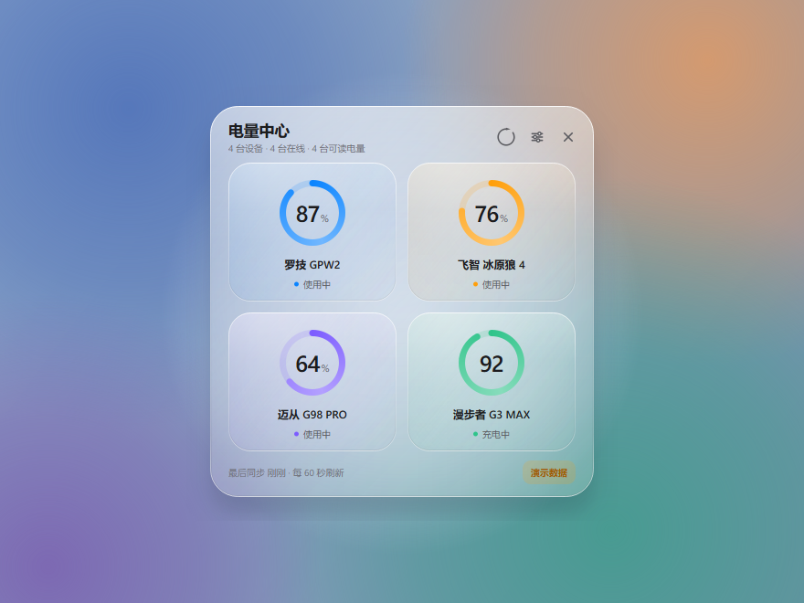
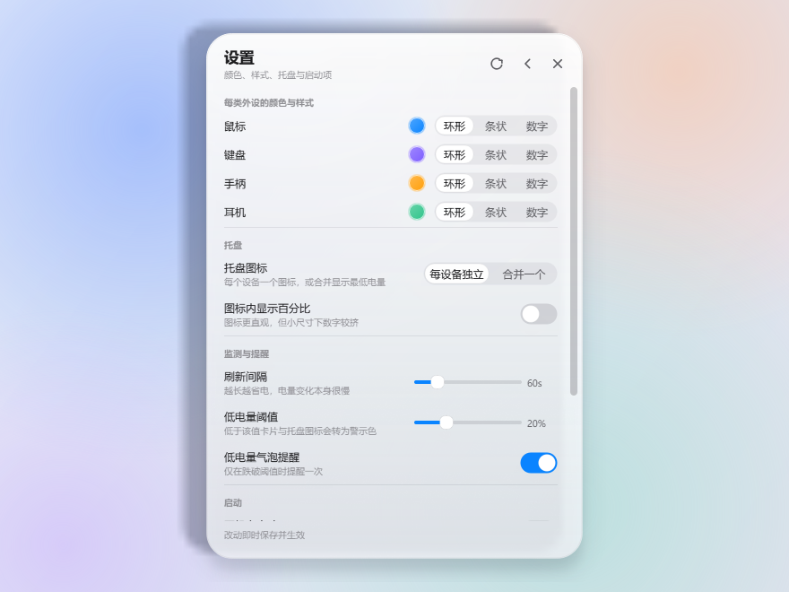
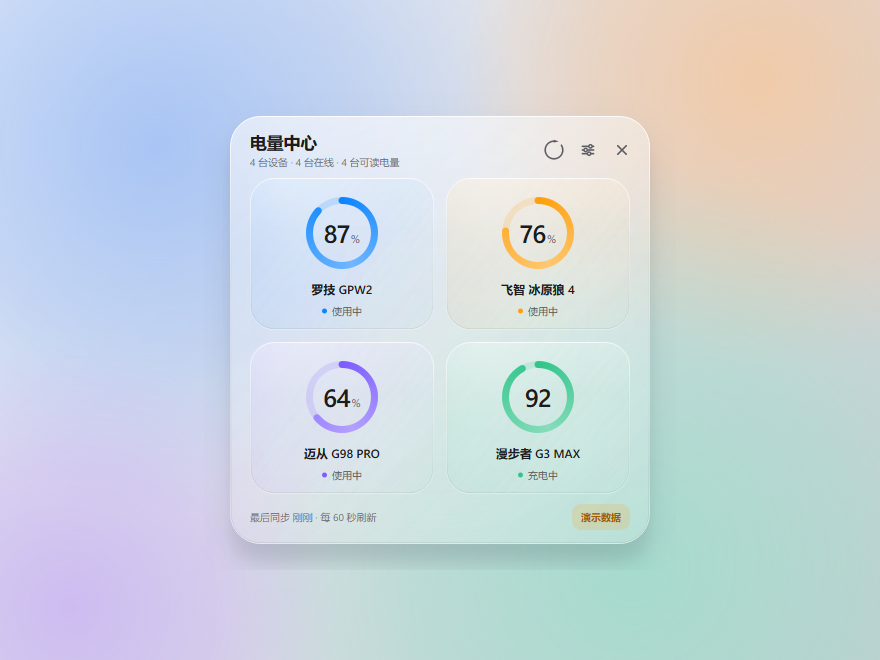
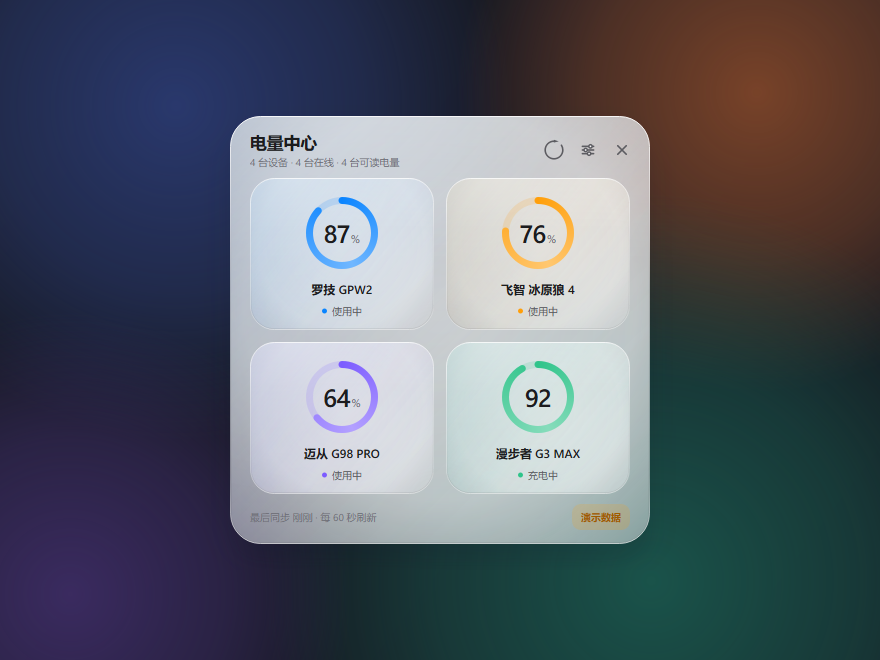

# 外设电量 · PeripheralBattery

Windows 桌面端 2.4G 无线外设电量监测工具。常驻托盘，实时显示飞智冰原狼 4、迈从 G98 PRO、
罗技 GPW2、漫步者 G3 MAX 的电量与状态；界面为澎湃 OS 4 式**柔光玻璃**（会透出壁纸并跟着变色）；
设备接入完全配置化，新增型号不需要改代码。

<p align="center">
  
</p>

<p align="center">
  
  
</p>

<p align="center">
  
  
  
  <br>
  <sub>同一块玻璃，三种壁纸：亮背景下几乎不加白纱，越暗盖得越厚（自适应通透度）</sub>
</p>

---

## 一、当前实测状态（看这张表比看宣传语有用）

| 外设 | 识别方式 | 电量来源 | 实测结果 |
| --- | --- | --- | --- |
| 罗技 GPW2 | 接收器 `046D:C547` / 有线 `046D:C094` | HID++ 2.0 `0x1004` 统一电量；接收器走长报文 `0x11` + 设备索引 1，有线走索引 `0xFF` | ✅ 正常，接收器 59~61%，插线充电 71% |
| 飞智 冰原狼 4 | `045E:028E` XInput 兼容手柄 | `XInputGetBatteryInformation` | ⚠️ 2.4G 接收器把自己伪装成有线手柄（`BATTERY_TYPE_WIRED` + 满档，无 `WIRELESS` 标志），**拿不到电量**；已修正为不再误报「充电中」，显示「暂无电量」 |
| 迈从 G98 PRO | `258A:01BB` SINOWEALTH 2.4G 接收器 | 主动查询：20 字节帧 `13 4A 01 00 02 00` + 帧尾 sum8 校验 → 应答第 6 字节 | ✅ 正常，读到 100%（9~22 ms，与 M HUB 一致） |
| 漫步者 G3 MAX | `35BB:A226` Jieli 2.4G dongle | 主动查询：`D0 35 BB 01 00` → 应答第 6 字节 | ✅ 正常，读到 48%（与驱动标题栏一致） |

说明：厂商 dongle 都是"私有协议"，没有任何公开文档，**唯一可靠的办法是在真机上抓报文**。
本项目把这件事做成了"改配置"，而不是"改代码"，并提供两个层次的工具：
`tools/usb_probe.py`（被动监听/Feature 枚举）与 `tools/hid_trace.py`（在驱动进程里看它到底发了什么）。
另外，罗技鼠标休眠时不会应答 HID++ 请求，界面会显示「休眠中」并保留上次电量，动一下鼠标即可刷新。

---

## 二、整体方案

参考 [USB Device Viewer](https://www.codertools.net/tools/usb-device-viewer.php?lang=zh) 的思路：
**先把设备枚举清楚，看清它暴露了哪些 HID Usage，再决定用哪种协议去读**。
所以整个程序是"枚举 → 匹配 → 协议 → 状态 → 呈现"的一条流水线，每层都可替换。

```
┌──────────────────────────── UI 层（PySide6 / 全自绘） ────────────────────────────┐
│  托盘图标（每设备一枚，动态绘制）   玻璃面板（卡片 / 环形电量）   设置页（颜色·样式）  │
└───────────────────────────────▲──────────────────────────────────────────────────┘
                                │ Signal(dict[device_id, Snapshot])
┌───────────────────────────────┴──────── 监测线程（单个 QThread） ─────────────────┐
│  定时唤醒 → 枚举 HID → 按设备匹配 → 逐台读数 → 合并历史/离线/休眠 → 广播快照        │
└───────────────────────────────▲──────────────────────────────────────────────────┘
                                │ Reading(level, charging, detail, source)
┌───────────────────────────────┴──────── 协议层（可插拔） ─────────────────────────┐
│  logitech_hidpp：HID++ 2.0（0x1004 / 0x1000 / 0x1001 / 0x0005）                    │
│  xinput        ：Windows XInput 电池 API（四档）                                   │
│  hid           ：标准 HID Battery Strength → 回退到配置驱动的厂商报文解析            │
│  vendor_query  ：主动发查询命令再解析应答（漫步者 G3 MAX 走这条）                    │
│  demo          ：演示数据                                                          │
└───────────────────────────────▲──────────────────────────────────────────────────┘
                                │ 字节流
┌───────────────────────────────┴──────── 设备层 ──────────────────────────────────┐
│  hidapi（枚举/读写） + hid.dll HidP_*（报告描述符、Usage 解析、Usage 取值）           │
└──────────────────────────────────────────────────────────────────────────────────┘
```

数据流很短：**设备 → Reading → Snapshot → 像素**。任何一层出问题都不会拖垮别的设备，
单台设备读取异常只会让它自己那张卡片变成"未连接 / 暂无电量"，并附带原因。

---

## 三、关键技术点

### 1. 设备枚举与"看清 Usage"
`hidapi` 负责拿到 `path / vid / pid / usage_page / usage`，`hid.dll` 的
`HidD_GetPreparsedData` + `HidP_GetValueCaps` 负责把「这个接口暴露了哪些 Usage」列出来，
`HidP_GetUsageValue` 再按 Usage 从原始报文里取值。这样标准电量页
（Usage Page `0x06` / Usage `0x20` Battery Strength）不需要手写位偏移就能读。

> 踩坑记录：`HidP_*` 的返回值是 NTSTATUS 风格，成功是 `0x00110000` 而不是 `0`，
> 用 `!= 0` 判断会把所有设备都判成失败。

### 2. 罗技 HID++ 2.0（本项目最硬的一段）
- 接收器上会同时出现 **7 字节**和 **20 字节** 两个 vendor 接口。
  20 字节接口必须发 **长报文 `0x11`**、7 字节接口发 **短报文 `0x10`**，混用会被系统直接拒绝（错误 5 / 错误 1）。
- 新固件的 GPW2 没有 `0x1000`，只有 `0x1004 UNIFIED_BATTERY`：
  先用 root `0x0000` 的 `getFeature(0x1004)` 换到 feature index（本例是 6），再调 `fn1 getStatus`，
  返回 `[电量%, 电量状态, 充电类型, 外部供电]`，充电类型 `0` 表示放电中。
- 设备索引不写死：遍历 1-6 用 `0x0003` 探活，再用 `0x0005` 读设备名做型号匹配；
  索引 0xFF 作为有线模式兜底。索引探测结果缓存 5 分钟，避免每轮都全表试探。
- **休眠与离线必须区分**：休眠是"没应答"（Timeout），未配对是"错误码 0x08"。
  两者在界面上是不同文案，否则用户会以为设备掉了。

### 3. XInput 手柄电量
`XInputGetBatteryInformation` 只返回 4 档 + 电池类型，四档折算为 5/25/60/100。

**`BATTERY_TYPE_WIRED` 是个陷阱**：2.4G 接收器会把自己伪装成"有线供电"的 Xbox 手柄，
Windows 就固定报"满"档，`XInputGetCapabilities` 的 `Flags` 里也没有 `XINPUT_CAPS_WIRELESS`。
早期版本把它翻译成"充电中 + 空电量"，等于在没插线的时候谎称正在充电。
现在的处理是 **`level=None` + `charging=None`**（"不知道"），界面显示「暂无电量」，
既不编数字也不编状态。

顺带一提：四档之外的未知 `BatteryLevel` 同样返回 `None` —— 宁可没有数字，也不硬凑一个 100。
要真正的百分比，只能走厂商协议（见第 4 条）。飞智的完整协议在 SDL 的
`SDL_hidapi_flydigi.c` 里有（V1 写 `05 EC`；V2 写 `03 5A A5 01 02 00`，应答 `data[11]`
高 4 位是充电状态、低 4 位是电量档 ×20），但**只有手柄工作在 DInput 模式、
暴露厂商 HID 接口时**才能用；2.4G/XInput 模式下这条通道根本不存在。

### 4. 配置驱动的厂商报文解析（扩展性的核心）
`devices.json` 里每台设备描述"怎么找到它"和"怎么读它"。厂商 dongle 分两类，配置里也是两套：

**① 被动式（`hid`）** —— 设备会自己往外推电量，我们只负责接住：

```json
"protocol": {
  "name": "hid",
  "init": ["07 02 00 00"],                       // 可选：先发唤醒/查询报文
  "parse": {                                     // 从上报里取电量
    "prefix": "5A A5", "mask": "FF FF",          // 前缀 + 掩码匹配
    "offset": 4, "scale": 1,                     // 第 4 字节即电量
    "charging_byte": 5, "charging_bit": 1
  }
}
```

**② 主动问答式（`vendor_query`）** —— 不问不说话，问一句答一句（迈从、漫步者都是这种）：

```json
"protocol": {
  "name": "vendor_query",
  "command": "13 4A 01 00 02 00",   // 命令模板，支持 {vid_be}/{pid_le} 等占位符
  "report_length": 20,              // 一帧多少字节（含首字节报告 ID）
  "checksum": "sum8",               // 帧尾校验：前 n-1 字节求和取低 8 位（也支持 xor8）
  "reply_prefix": "13 4A 01 00 02", // 只认以此开头的应答
  "level_offset": 5,                // 电量在第 6 字节
  "timeout_ms": 400, "retries": 2
}
```

两个实测踩过的坑，都已经写进代码：

- **帧尾校验和**：迈从的 20 字节帧最后一字节 = 前 19 字节之和（`13 4A 01 00 02 00 … 60`）。
  不补校验和，设备直接不认。
- **回显帧**：这类 dongle 会把不认识的下行帧原样回显上来，回显帧与命令**逐字节相同**，
  而"电量位"恰好是 0 —— 不排掉就会显示成 **0%**，比读不到更糟。
  `read_vendor_query()` 里明确跳过与命令完全一致的帧。

`match` 的四个键（`vid` / `pid` / `usage_page` / `product_contains`）任意组合，
省略即不参与过滤。用户还可以在 `%APPDATA%\BatteryGlass\devices.json` 里追加或覆盖同名条目，
**不动安装目录**，升级不会丢配置。

### 5. 低占用是怎么做到的
- 单个 `QThread` 串行扫描，默认 **60 秒**一次；扫描完 `Event.wait(interval)` 睡死，不占 CPU。
- 读完立刻 `close()` 句柄，不长期占用 USB 接口；HID++ 索引缓存把每轮 USB 往返从 ~20 次降到 3~4 次。
- 托盘图标、面板控件全部按需重绘，没有常驻动画；窗口隐藏后不做任何绘制。
- 实测常驻内存约 60-80 MB（PySide6 运行时为主），空闲 CPU 占用 ≈ 0%。
- 手动刷新、USB 插拔（`WM_DEVICECHANGE` 广播）用事件立即唤醒，不做忙轮询。

### 6. 澎湃 OS 4 式柔光玻璃（自绘，不靠图片）

这块材质全部 `QPainter` 自绘，核心是**四件事**，缺一件就会退回"白色半透明塑料板"：

| 特征 | 做法 | 代码 |
| --- | --- | --- |
| **感知融色** | 把当前这块屏幕整屏截下来（1/8 缩放 + 模糊，约 50 ms / 230 KB），板材带着屏幕原点和缩放；控件按自己的**屏幕坐标**取像素，再从中提取一个降饱和的环境色 | `backdrop.py` |
| **自适应通透度** | 亮背景几乎不加白纱（×0.42），越暗加得越厚（最多 0.78），保证深色文字在深色壁纸下依然清楚 | `glass.adaptive_scrim()` |
| **边缘融色** | 白纱是**径向**的：中心厚、四边薄，壁纸颜色从边框渗进来 —— 这是和磨砂白板最直观的分界 | `glass.paint_glass()` ② |
| **光影秩序** | 顶部一道薄亮带 + 左上柔光 + 上缘亮边 / 下缘反光 / 内侧暗收口三笔描边，把"平板"画成"有厚度的一块玻璃" | `glass.paint_specular()` |

几个刻意为之的实现细节：

- **先缩到 1/8 再模糊**，既当模糊用，又把板材从 14 MB（2560×1440）压到 230 KB（320×180）；
  一次整屏取样约 50 ms，每 15 秒一次，摊下来的 CPU 占用可以忽略。
- **只统计有颜色的像素**求环境色，否则一片灰墙会把任何色调冲淡成灰。
- **截到纯黑就判失败**：独显全屏游戏 / 远程桌面下 `grabWindow` 会返回黑图，这种情况回落到
  静态玻璃（`base_alpha = 0.86`）或 DWM Acrylic，绝不把界面刷黑。
- **底图带坐标系**（屏幕原点 + 缩放），而不是"和窗口一样大的一张图"。
  这是拖动时颜色能跟着走的原因：面板到哪，取的就是那块屏幕的像素，不需要重新截屏。
- **重新取样时先抹掉面板自己**（`smear_rect`）：面板占的那块用两侧像素横向插值填平。
  不抹的话每刷一次就把面板的亮色糊进底图一层，玻璃会越来越白。
- **背景板小于控件时裁剪有效区域再映射**，避免源矩形越界导致整块背景突然消失。
- 叠在外壳上的卡片用 `backdrop_weight ≈ 0.3`，只透一点点背景 —— 否则卡片会把自己下面那块
  桌面再画一遍，看起来比周围更暗。
- 磨砂颗粒只留 **12%** 不透明度：柔光玻璃是"润"的不是"砂"的。

另提供可选的 **DWM Acrylic**（`SetWindowCompositionAttribute`）真实磨玻璃；自己截屏成功时
会主动清掉它，否则两层模糊叠在一起会糊成一片。

电量控件有 **环形 / 条形 / 数字** 三种形态。外观分两层：**按类型**给默认值，
**按单台设备**可单独覆盖（见第 9 条）。

配色也随材质调过：次要文字从 `#8E8E93` 压到 `#6E6E76`（白底 3.3:1 → 5.1:1），
徽标里的警告色单列 `WARN_TEXT = #A05A00` —— 原来的 `#FF9F0A` 铺在浅玻璃上只有 1.4:1。


### 7. 托盘与自启动
- 托盘图标是**代码绘制**的电池：颜色 = 该类型自定义色，填充量 = 电量，充电叠加白色闪电，
  低于 10% 整枚转红。支持"每设备一枚"与"合并一枚"两种模式（合并时取最低电量）。
- 图标按 16/18/20/24/32/40/48/64 多尺寸渲染，避免 DPI 缩放发虚。
- 开机自启写 `HKCU\...\CurrentVersion\Run`（免管理员），启动参数 `--tray` 直接静默进托盘。
- `QLocalServer` 单实例：重复启动只唤起已有面板，不会开第二个监测线程。

### 8. 设备清单的增删与自动发现
设备清单分三层，读写都落在 `%APPDATA%/BatteryGlass/devices.json`：

```
内置模板（随程序升级）  →  用户层（devices / removed / types）  →  运行时视图
```

- **手动新增**：设置页「添加设备…」，把当前枚举到的设备按 `VID:PID` 归并后列出来点选即可；
  也可以用 `VID`/`PID` 手填（设备此刻不在也能登记）。
- **手动删除**：清单里每行一个「移除」。删内置设备时写的是**墓碑**（`removed` 列表），
  否则下次启动重新读内置模板又会把它变回来。
- **自动新增**：监测线程每轮把"在用但没登记"的设备上报给界面线程落盘（写配置只在 UI 线程做）。
  会跳过 Windows 那堆 `HID Interface` / `USB Input Device` 之类的空壳接口，
  也会跳过用户删过的墓碑 id —— 删了就真的不会再冒出来。
- **自动收起断连设备**：断连超过设定时长（默认 10 分钟）的卡片和托盘图标一起收起，
  重新连上会自动回来。判定用的是 `last_seen`（读成功 / 检测到 / 休眠都算看见），
  而不是 `updated_at` —— 后者只在读到电量时前进，会把"一直读不到电量"的设备误判成离线。

自动登记的设备先按 `hid` 协议被动监听：能读标准电量页就直接生效，
读不到就显示「暂无电量」，再按第五节补 `protocol.parse` 或改 `vendor_query` 即可。

### 9. 单台设备的颜色与样式
外观有两层，取值顺序是 **单台设备 → 所属类型 → 内置默认**：

| 层 | 作用 | 存在哪 |
| --- | --- | --- |
| `colors` / `styles` | 按类型的默认值，新设备接入后自动继承 | `preferences.json` |
| `device_colors` / `device_styles` | 按设备的覆盖值，key 是 device id | 同上 |

- 设置页每条设备行右侧：点颜色圆点改这一台的颜色，下面一行切它的
  环形 / 条状 / 数字；改完立即生效并落盘，副标题会标上「已自定义」。
- 卡片、托盘图标、托盘菜单、右键菜单全部走同一个取值函数，
  所以改一次是全链路生效，不存在"卡片变了托盘没变"。
- 非法值（`紫色`、`donut`）在写入和加载时都会被丢掉，自动回落类型默认 ——
  宁可没自定义，也不能让界面拿到坏颜色画出一片黑。
- 撤掉自定义用 `Preferences.reset_device(id)`（`device_colors` / `device_styles`
  里删掉对应 key 即可）。

---

## 四、目录结构

```
外设电量显示软件_DeepSeek版/
├─ main.py                  入口：单实例、参数、装配
├─ run.bat                  一键启动（首次自动建 venv 装依赖）
├─ requirements.txt
├─ app/
│  ├─ config/devices.json   ★ 设备清单（新增型号改这里）
│  ├─ core/
│  │  ├─ paths.py           源码/打包两种运行环境的路径
│  │  ├─ config.py          设备注册表（内置+用户层+墓碑）+ 偏好设置持久化
│  │  ├─ discovery.py       设备发现：按 VID:PID 归并接口、生成可入册的配置
│  │  ├─ presence.py        断连判定（last_seen → 是否该收起）
│  │  ├─ model.py           Reading / Snapshot 数据模型
│  │  ├─ hidapi_io.py       hidapi 枚举与句柄（带超时）
│  │  ├─ hidnative.py       hid.dll：Value Caps、Usage 取值、报告描述符
│  │  ├─ protocols.py       HID++ / 通用 HID / 厂商报文
│  │  ├─ xinput.py          XInput 电量
│  │  ├─ monitor.py         后台监测线程
│  │  ├─ autostart.py       开机自启注册表
│  │  └─ demo.py            演示数据
│  └─ ui/
│     ├─ theme.py           颜色/字体/全局 QSS
│     ├─ backdrop.py        桌面取样：截屏 → 模糊 → 提取环境色（感知融色的地基）
│     ├─ glass.py           柔光玻璃绘制、开关、分段控件、胶囊按钮、矢量图标按钮
│     ├─ gauge.py           环形/条形/数字电量控件
│     ├─ cards.py           设备卡片
│     ├─ settings.py        设置页（设备清单 / 颜色 / 样式 / 托盘 / 启动）
│     ├─ add_device.py      新增设备对话框
│     ├─ panel.py           主面板（无边框 + 拖动 + 热插拔监听）
│     ├─ tray.py            托盘图标与菜单
│     └─ winblur.py         DWM Acrylic
└─ tools/
   ├─ selfcheck.py          ★ 一键自检（环境/配置/逐台读数）
   ├─ usb_probe.py          ★ 设备诊断/被动抓包（接入新设备用）
   ├─ hid_trace.py          ★ 在驱动进程里追踪 HID 通信（私有协议定位）
   ├─ make_icon.py          生成 app.ico
   ├─ screenshot.py         界面预览图（--live 真实设备数据 / --wall=light|mid|dark 换壁纸）
   └─ build_exe.py          PyInstaller 打包
```

---

## 五、怎么新增一台外设（三步）

**第 1 步：看清设备。**

```bat
.venv\Scripts\python.exe tools\usb_probe.py list
```

输出里找你的设备，记下 `VID:PID` 和 `UP`（Usage Page）。若"电量页"一列是 ✔，直接跳到第 3 步，
配置 `"protocol": {"name": "hid"}` 即可。

**第 2 步：抓报文。** 先把接收器插好、设备开机，然后：

```bat
.venv\Scripts\python.exe tools\usb_probe.py watch --vid 0x258A --pid 0x01BB
```

工具会打印去重后的报文，并给出"值在 1-100 且稳定"的候选字节。抓的时候最好操作一下设备
（按键、切模式），让厂商协议主动上报。若设备需要先被查询才回复，可以用 `--init "07 02 00 00"` 试探。

**第 3 步：写进配置。** 在 `app/config/devices.json` 的 `devices` 数组里加一条
（或写到 `%APPDATA%\BatteryGlass\devices.json` 覆盖），保存后点面板右上角刷新即可，
**不用重启、不用改代码**：

```json
{
  "id": "my-keyboard",
  "type": "keyboard",
  "display_name": "我的键盘",
  "match": { "vid": 9610, "pid": 443 },
  "protocol": {
    "name": "hid",
    "init": [],
    "parse": { "prefix": "", "offset": 3, "scale": 1 }
  }
}
```

`type` 决定它的颜色与显示样式（在设置页里逐类调整），也可以直接在 `types` 里新增一个分类。

---

## 六、运行与打包

```bat
:: 0) 先自检一眼（不弹界面）
.venv\Scripts\python.exe tools\selfcheck.py

:: 1) 直接跑（首次会自动建虚拟环境）
run.bat

:: 2) 手动跑
.venv\Scripts\python.exe main.py          :: 启动并弹出面板
.venv\Scripts\pythonw.exe main.py --tray  :: 静默进托盘（开机自启用这个）
.venv\Scripts\python.exe main.py --demo   :: 演示数据，先看界面

:: 3) 打包成 exe
.venv\Scripts\python.exe -m pip install pyinstaller
.venv\Scripts\python.exe tools\build_exe.py            :: 单文件 dist\外设电量.exe
.venv\Scripts\python.exe tools\build_exe.py --onedir   :: 目录版，冷启动更快
```

用户配置与日志在 `%APPDATA%\BatteryGlass\`（`preferences.json` / `devices.json` / `app.log`）。
卸载直接删目录即可，自启动项在设置里关掉或从任务管理器「启动应用」里禁用。

### 测试

```bat
.venv\Scripts\python.exe -m pip install -r requirements-dev.txt
.venv\Scripts\python.exe -m pytest
```

- UI 测试跑在离屏 Qt（`QT_QPA_PLATFORM=offscreen`）上，不弹窗、不抢焦点，可直接在 CI 里跑。
- 图标测试不是截图比对，而是测量外轮廓的径向分布：弧半径缩水、缺口跑位、箭头飞出圆外都会立刻失败。
- 设备管理测试全部用临时目录 + 构造的 HID 列表，不碰真实硬件，也不动 `%APPDATA%` 里的配置。
- 单独跑某一组：`.venv\Scripts\python.exe -m pytest tests/test_ui_icons.py -v`

| 测试文件 | 覆盖内容 |
| --- | --- |
| `test_ui_icons.py` | 刷新图标的圆度、缺口与箭头几何（含"旧几何必须失败"的对照实验） |
| `test_protocol_vendor.py` | 漫步者主动查询协议：报文构造、应答解析、越界与异设备帧 |
| `test_protocol_hidpp.py` | HID++ 有线模式（索引 `0xFF`）探测与超时兜底 |
| `test_config_devices.py` | 设备清单增删、墓碑、用户层覆盖、偏好新字段 |
| `test_discovery.py` | 接口归并、已登记排除、通用名过滤、id 冲突 |
| `test_presence.py` | 断连判定的时间边界与 `last_seen` 语义 |
| `test_ui_devices.py` | 设置页清单、新增对话框、面板自动登记 / 自动收起 |
| `test_preferences_devices.py` | 逐设备外观的取值优先级、非法值回落、持久化与界面联动 |
| `test_ui_glass.py` | 柔光玻璃：环境色取样、模糊、空白截屏回落、白纱自适应曲线（含单调性）、边缘融色、顶部受光、悬浮提亮；整屏取样的原点/缩放换算、移动后取样位置变化、抹掉面板自己那块 |


---

## 七、已知限制

1. **私有协议无文档**：迈从、漫步者的 dongle 走厂商自定义报文，必须真机抓包才能定位电量字节；
   本项目提供工具与配置位，但不猜测协议（乱写 Feature 报文有改坏设备配置的风险）。
2. 罗技鼠标休眠时无应答，属协议行为；电量刷新依赖设备被唤醒。
3. XInput 只有 4 档精度；有线供电时无档位可用。
4. 若同时装了 Logitech G HUB，个别情况下 HID++ 接口会被独占，表现为读取失败（日志里可见）。
5. 设备清单的增删、以及单台设备的颜色/样式都即时生效，不需要重启。
6. 柔光玻璃的底图是**整屏取样**：面板拖动时颜色跟着走，显示期间每 15 秒重取一次，
   换壁纸最迟半分钟内跟上。隐藏时定时器停掉，不做任何截屏。
   独显全屏游戏、部分远程桌面下截屏会返回黑图，此时自动回落到静态玻璃。
   多显示器下只取面板所在的那块屏；面板跨屏拖动时，超出那块屏的部分会用板材边缘色。

---

## 八、还可以往哪走

- 给未支持设备加一个"校准向导"：面板内引导抓包 → 自动生成 `parse` 配置。
- 电量历史落盘（SQLite），面板里画 7 天曲线，顺便估算剩余可用时长。
- 用 `--low-power` 模式：面板隐藏时 5 分钟一次，面板打开时 10 秒一次。
- 备选协议：BLE HID（`Windows.Devices.Bluetooth`）/ 罗技 `0x1001` 电压曲线精修。
